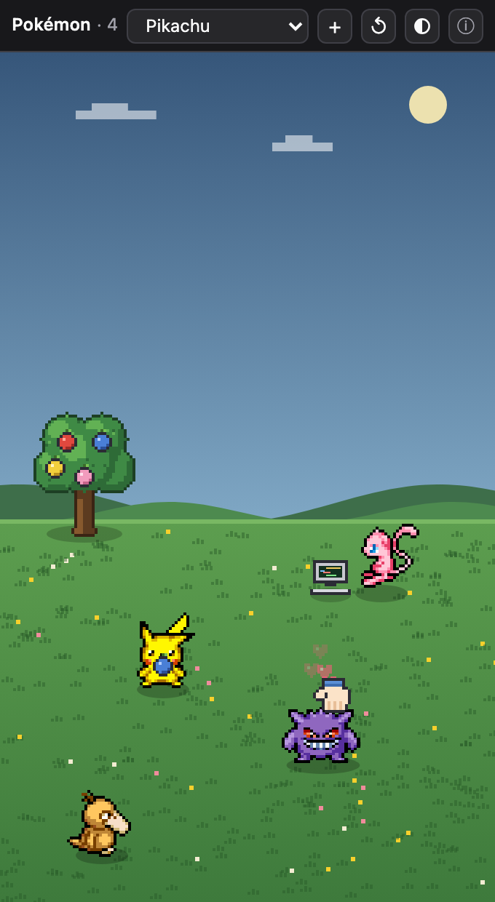
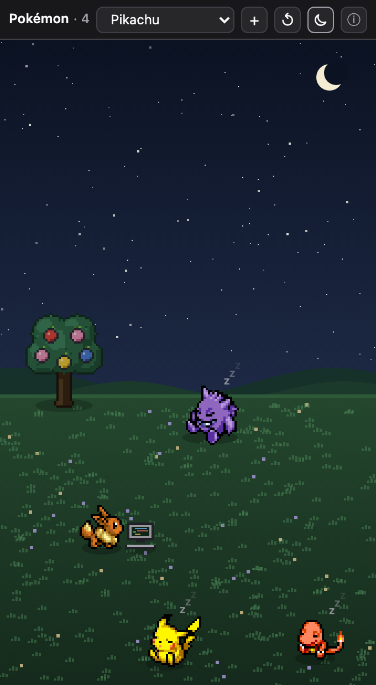

# Orca Pokémon

A Pokémon pack for [Orca](https://github.com/stablyai/orca): a **Pokémon Pets** panel where pixel Pokémon wander around while you work, plus six Pokémon-inspired terminal themes.

| Day | Night |
| --- | --- |
|  |  |

## Pokémon Pets panel

- 12 Pokémon with real walk, idle, sleep, hop and eat animations (Pikachu, Bulbasaur, Charmander, Squirtle, Eevee, Gengar, Jigglypuff, Meowth, Psyduck, Snorlax, Mew, Togepi).
- They stroll, stop, look around, and doze off — at night the sky turns dark, stars come out and most of them fall asleep (Snorlax mostly sleeps anyway).
- They work, too: every so often whoever is around picks up a job, trots to an open patch of grass and pulls out its own kit — a little PC for coding, the Pokédex to research another Pokémon, a pocket Pokémon Center machine for tests, an anvil to build a Poké Ball, or a letter it sends flying to ship the release. Any Pokémon can take any job, and the team loosely follows a code → test → build → deploy flow.
- The sky follows your clock (day, dusk, night), or force one with the sky button — it cycles Auto → Day → Dusk → Night, and the Pokémon react right away.
- A berry tree stands at the back of the field. Click a berry (or drag it) to pick it, then bring it to a Pokémon: it turns to you and munches it in three bites, then hops happily. Let go anywhere else and the berry hops back onto its branch; eaten ones regrow, and the tree never shows more than two of one color. Food wakes up sleepers, and a worker takes a quick snack break.
- Press on a Pokémon and rub to pet it: a hand pats its head in time with your rubbing, it squashes under each pat and hearts float up.
- Click a Pokémon to make it hop and show its name (or, while it works, what it's working on). Add more with **+** (up to 10), reset with **↺**.
- Lightweight: a single sandboxed HTML document, capped at 30 fps, paused while hidden; respects `prefers-reduced-motion`.

### Install

1. Clone this repo.
2. In Orca, open **Settings → Plugins**, turn the plugin system on, and add `plugin/pokemon-pets` (inside your clone) as a development plugin folder.
3. Approve **Pokémon Pets** when Orca asks.
4. Open the right sidebar and pick the **Pokémon** panel.

## Terminal themes

Six Warp-format themes in [`themes/`](themes): Pikachu, Gengar, Charizard, Blastoise, Venusaur (dark) and Mewtwo Light. All text colors keep at least 4.5:1 contrast, and red/green/yellow stay recognizable so errors and diffs still read at a glance.

Install: **Settings → Terminal → Import from YAML**, choose the `themes` folder, then pick a theme for dark and/or light mode.

## Building the panel from source

The panel is one self-contained HTML file (Orca panels may only load inline scripts and `data:` images), so the sprite sheets are embedded at build time:

```sh
python3 plugin-src/build.py
```

This reads `plugin-src/panel.template.html` and `plugin-src/sprites/`, and writes `plugin/pokemon-pets/`. To add a Pokémon, drop its sheets from the PMD Sprite Repository into `plugin-src/sprites/<dex number>/` and add it to `ROSTER` in `build.py`.

## Credits

- Sprites: [PMD Sprite Repository (SpriteCollab)](https://github.com/PMDCollab/SpriteCollab), licensed CC BY-NC 4.0 — per-sprite authors are listed in [`plugin/pokemon-pets/CREDITS.md`](plugin/pokemon-pets/CREDITS.md).
- Pokémon © Nintendo / Creatures Inc. / GAME FREAK inc. This is an unofficial fan project for personal, non-commercial use.
